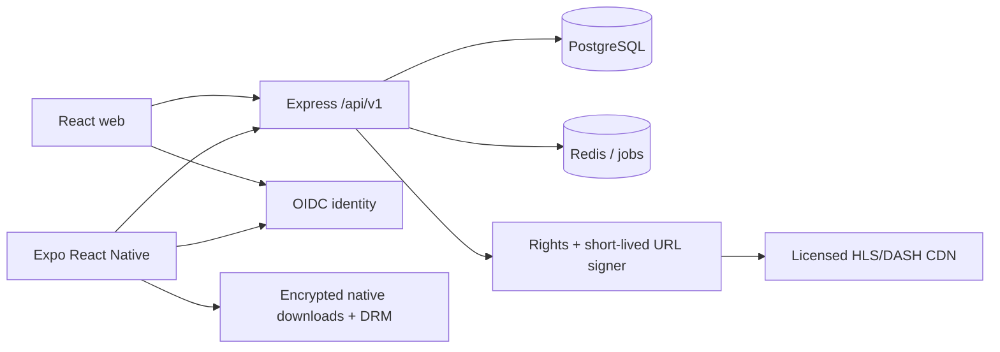

# Flixora architecture

Flixora is organized as a modular monolith with separate web and mobile clients. The repository can run as a polished local product demo, while the API and schema define the boundary for a licensed production service.

## Technology choices

- Web: React 19, Vite, hls.js, responsive CSS, lazy player loading.
- Mobile: Expo/React Native with strict TypeScript, AsyncStorage for demo state, and `expo-video` over AVPlayer/ExoPlayer.
- API: Node.js 22+, Express 5, Zod request validation, `pg`, OIDC/JWKS verification, security headers, exact-origin CORS, and request throttling.
- Data: PostgreSQL 16. Redis is recommended for distributed limits, cache, session concurrency, and jobs.
- Media: managed transcoding to HLS/DASH, private object storage, licensed CDN, DRM provider, and five-minute server-signed playback URLs.

Keep profiles, catalog, playback/rights, library, community, and recommendations as internal modules until independent scaling is justified. Transcoding and event/recommendation workers should run separately from request handling.

## Clients and screens

| Area | Web implementation | Mobile implementation |
| --- | --- | --- |
| Home | Spotlight hero, Continue Watching, trending, recommendation, and Top 10 rails | Hero, curated rails, profile-aware catalog |
| Discover | Title search and genre/type/year/rating/language/country filters | Search, genre filters, responsive cards |
| Details | Metadata, watchlist, quality queue, rating/review | Metadata, watchlist, download queue, playback |
| Player | Source failover, audio/subtitle/episode choices, ±10s, speed, resume, fullscreen | Native controls, PiP/fullscreen, source switching, speed, seek, periodic progress |
| Downloads | Clearly labelled simulated state machine with storage/progress/pause | Queue foundation; native DRM/background downloads remain a provider integration |
| Profiles | Isolated demo data, Kids restriction, demo adult PIN | Isolated AsyncStorage and Kids restriction |

The demo profile PIN is deliberately shown as `1234` and is not security. Production routes use server-side scrypt hashes, a database-backed five-attempt lockout, and a 15-minute profile-bound unlock JWT signed with `PROFILE_UNLOCK_SECRET`.

## API surface

All new routes use `/api/v1`:

- health and database readiness;
- public catalog filtering, title episodes, approved reviews/comments, public playlists, and territory Top 10;
- authenticated profile CRUD and secure PIN management/unlock;
- profile-owned watchlist and optimistic playback history;
- viewing events, explainable recommendation snapshots, ratings, comments, and curated playlists;
- licensed playback-session issuance after ownership, PIN, age, territory, rights, episode, source availability, and signer checks.

`DEMO_MODE=true` exposes only a read-only in-memory catalog when PostgreSQL is absent. It never enables authenticated writes or fake licensed playback. API tests create ephemeral local servers with fake dependencies and do not require a live database.

## Identity and authorization

Clients authenticate with an external OIDC provider using Authorization Code + PKCE and store mobile refresh material in OS secure storage. The API verifies JWT signature, issuer, audience, expiry, algorithm, and subject through remote JWKS. `AUTH_JWKS_URL` can override the provider default.

The stable OIDC subject maps to `users.auth_subject`; provision that row transactionally during signup/webhook processing before creating profiles. Every profile route checks that the authenticated subject owns the profile. Kids rules and maximum age rating are enforced again in SQL-backed API paths, including watchlist, history, events, community writes, recommendations, playlist items, and playback.

Never expose a privileged database connection, signing secret, DRM key, provider token, or raw storage key to either client.

## Database model

[db/schema.sql](../db/schema.sql) is a PostgreSQL 16 bootstrap for a new database. Use a migration tool for later changes.

Users own profiles and devices. Media contains movies, series, anime, and documentaries; episodes have composite identity with their parent media. Stream assets store private relative manifest keys, priority, region, availability, track metadata, and DRM identifiers. Time- and territory-bound rights gate playback and offline eligibility.

Profile data includes watchlists, versioned playback history, ratings, moderated comments, playlists, viewing events, and generated recommendation sets with explanations. Daily territory rankings support Top 10. Downloads include both user and device ownership so cross-account combinations are rejected by composite foreign keys. Threaded comment parents must belong to the same media title.

The schema adds update triggers and indexes for active rights, stream lookup, history, public playlists, community views, rankings, and recommendations. The server should use a least-privilege role and transactions for multi-write operations. Configure row-level security before allowing any direct Supabase data access; the current design expects all data access through Express.

## Filtering and recommendations

`GET /api/v1/media` validates a strict query shape and parameterizes every SQL value. Supported fields include `q`, genre, release year, country, language, IMDb threshold, media type, page, and limit. Country values normalize to uppercase and unknown query keys fail with `400`.

The initial recommendation model is explainable: genre affinity, completion, explicit rating, recency, and territory popularity. Store impressions, starts, progress, and completion with retention rules. Recommendation snapshots include a human-readable reason such as “Because you watched…”. Daily Top 10 should count unique engaged profiles, cap repeated activity, and filter by rights and profile age.

For a large catalog, replace offset pagination with a `(popularity, id)` cursor and tune PostgreSQL full-text search with language-specific configurations.

## Playback and failover

The web demo plays public sample footage. A production client requests `POST /api/v1/profiles/:profileId/playback-sessions`; it never submits an arbitrary source URL. The server checks ownership, optional unlock token, territory, active rights, age limit, media/episode relationship, and enabled source availability. It returns up to three prioritized, short-lived signed URLs without exposing storage keys.

Clients preserve the current timestamp while switching to the next authorized source, bound retries, and refresh expired sessions through the API. Persist progress every 10–15 seconds and on pause/background/exit with an event UUID and expected version. A stale device receives `409` and must reconcile with the latest server version.

Web HLS uses hls.js where Media Source Extensions are available and native HLS on Safari. DASH/DRM on the web should use a dedicated Shaka Player adapter. Source metadata may advertise tracks; a track selector only becomes functional when the manifest actually contains those tracks.

## Offline playback

The browser download manager is a UI simulation. Real offline media belongs in the mobile adapters:

- iOS: `AVAssetDownloadURLSession`, FairPlay persistent content keys, encrypted app storage;
- Android: Media3 `DownloadService`, Widevine offline licenses, encrypted app storage;
- server: device/title authorization, allowed resolution, quota, asset checksum, and license expiration.

Handle background execution, partial recovery, deletion, storage pressure, renewal, and automatic cleanup. Offer 4K only when the asset, device, entitlement, and rights all allow it.

## Community safety

Ratings, comments, and public playlists require authenticated ownership, strict lengths, throttling, moderation, reporting, blocking, and deletion/export workflows. Public reads return approved content only. Render all user content as text; never inject review HTML. Kids profiles cannot post community content through the production API.

## Production gates

Before release, add real migrations and rollback tests, disposable PostgreSQL integration tests, Redis-backed rate limits, exact deployed CORS origins, transactional user provisioning, billing/entitlements, licensed artwork/catalog, CDN/DRM integration, encrypted native downloads, moderation operations, audit logs, metrics/traces, backups and restore drills, privacy retention, and mobile/web end-to-end tests.

The included API and database contracts are substantial foundations, but no repository can provide movie rights, DRM credentials, production identity, or store distribution certificates without those external services. TLS and certificate verification must remain enabled throughout setup and deployment.
